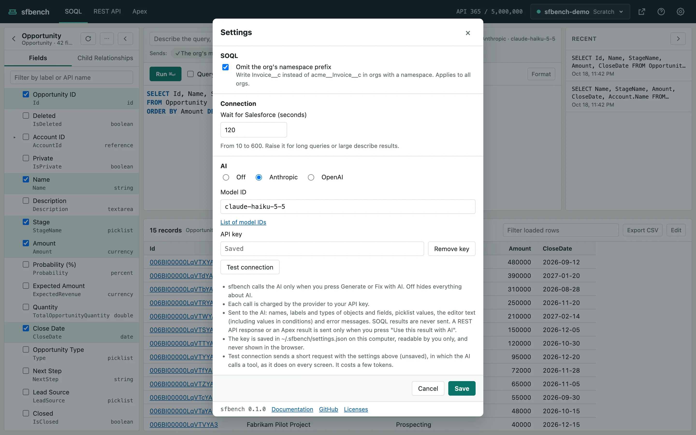

# sfbench help

sfbench runs Salesforce SOQL, REST API requests and anonymous Apex in your browser, on your own machine.
It uses the auth you already have in the sf CLI.

[日本語](../ja/README.md)

- [Getting started](#getting-started) (this page)
- [SOQL](soql.md)
- [REST API](rest.md)
- [Anonymous Apex](apex.md)
- [Writing with AI](ai.md)
- [Troubleshooting](troubleshooting.md)

## Getting started

### Requirements

- Node.js 22.21.0 or later in the 22 line, or 24.5.0 or later
- The [Salesforce CLI](https://developer.salesforce.com/tools/salesforcecli) (`sf`)

Log in to the orgs you use with the sf CLI:

```
sf org login web -a my-org
```

### Start sfbench

```
npx sfbench
```

sfbench opens in your browser.
If the sf CLI has a default org (set with `sf config set target-org <alias>`), sfbench opens it.
To open another org, give it with `-o`:

```
npx sfbench -o my-org
```

sfbench starts a small web server on your machine, and that server sends the requests to Salesforce.
The access token never goes to the browser or to any other server.
The server keeps running until you stop it:

```
npx sfbench stop
```

### The screen


The bar at the top (the header) holds, from left to right:

- **Tabs**: switch between the SOQL, REST API and Apex screens. Each screen keeps what you typed and its result while another is shown.
- **API usage**: the org's API calls and their limit.
- **Org switcher**: the alias and kind of the org you use. Click it to open the list of orgs.
- **Open org** (the external link icon): opens the org's home in a new tab, logged in. Once it is open, the record ID links in results open directly too.
- **?**: opens this help.
- **Gear**: opens the settings.

### Switch orgs

The org switcher lists the orgs you are logged in to with the sf CLI.
Type in the box at the top to filter by alias or username.

- Production orgs are shown in red. When you choose one, a red PRODUCTION bar shows under the header.
- Scratch orgs show their expiration date.
- Orgs that need a new login are grouped at the bottom under "Orgs that need a new login", with the command to log in again, ready to copy.

Switching orgs clears the work on the screen, such as the editor and the result.

### Confirmations in production orgs

In a production org, sfbench asks before anything that may change data: a REST API request other than GET, running Apex, and saving in the result table.
Running SOQL only reads, so it is not confirmed.

### Settings

Click the gear in the header to open the settings.



- **SOQL**: with "Omit the org's namespace prefix" on, you can write `Invoice__c` instead of `acme__Invoice__c` in an org with a namespace.
- **Connection**: how many seconds to wait for Salesforce. Raise it for long queries or large describe results.
- **AI**: the AI provider, model ID and API key. See [Writing with AI](ai.md).

Settings, recent queries, and the REST API and Apex histories are saved in `~/.sfbench/` on your machine.

### Open sfbench from an AI agent

AI agents such as Claude Code can open sfbench with a query, a request or Apex filled in.
Agents do not know sfbench yet, so tell them in their instructions (`CLAUDE.md`, `AGENTS.md`); the lines to add are in the [README](../../README.md#from-an-ai-agent).

```
npx -y sfbench -o my-org --query "SELECT Id, Name FROM Account" --run
npx -y sfbench -o my-org --rest /services/data/v62.0/sobjects/Account --method POST --body-file account.json
npx -y sfbench -o my-org --apex-file fix-data.apex
```

With `--run`, the `--query` SOQL is run and its result is shown.
A REST API request or Apex, which may change data, is only filled in: check it, then send or run it with the button on the screen.
All the options are in the [README](../../README.md#command-line-options).
