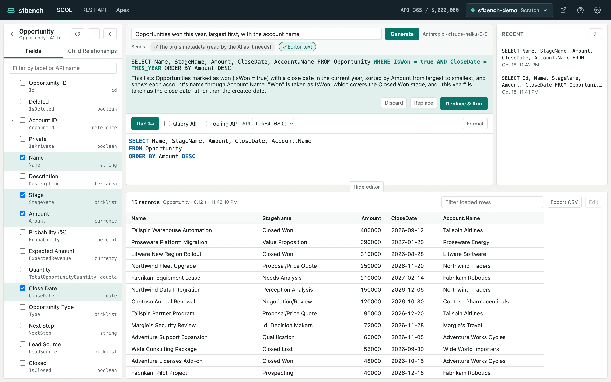
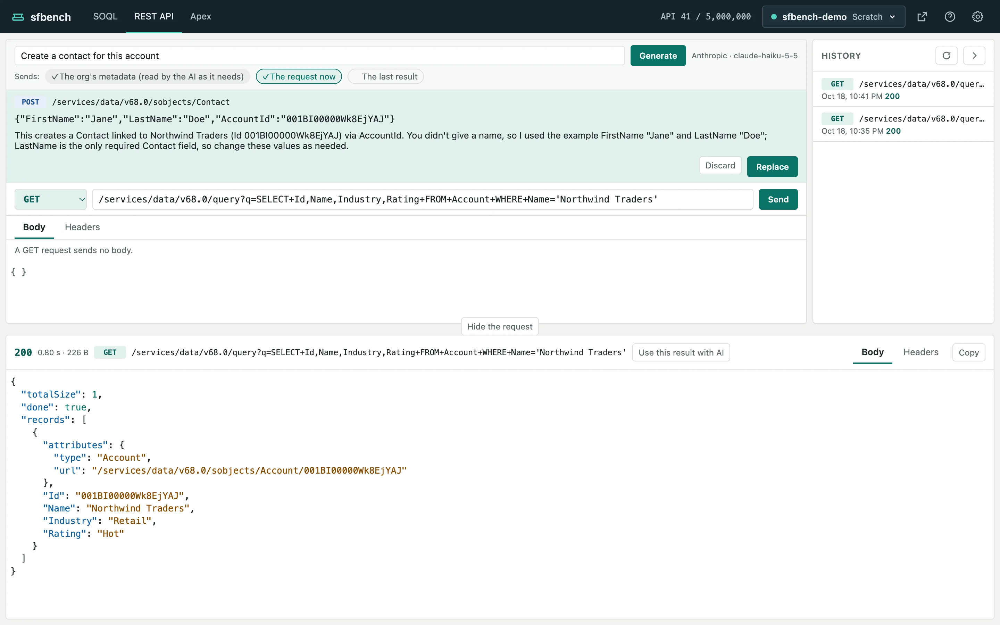

# Writing with AI

[Help contents](README.md)

Write what you want, and an AI writes the SOQL, the REST API request or the anonymous Apex.
The AI can also fix a query, a request or Apex that failed, from its error.

## Set up

You need an API key from Anthropic or OpenAI.
Each call is billed to the key's owner by the provider.

1. Click the gear in the header to open the settings.
2. Under AI, choose Anthropic or OpenAI.
3. Enter the model ID. "List of model IDs" links to the models you can use.
4. Enter the API key.
5. Click Test connection to send short requests with what you entered. They cost a few tokens.
6. Click Save.

The key is saved in `~/.sfbench/settings.json` on your machine, readable by you only, and never shown in the browser.
Choosing Off hides everything about AI.

## Ask

Write what you want in the box at the top of a screen, and click Generate (or press Enter).

- SOQL: "opportunities won this month, largest first"
- REST API: "create an account", "show the API usage"
- Apex: "change all Hot accounts' rating to Warm"

The AI looks up the org's objects and fields before writing.
If the editor already holds a query or code, the AI takes it as a starting point.

## Take a proposal

The AI's answer shows as a proposal under the input.
When the editor is not empty, the proposal shows the differences from what is there.
Nothing on the screen changes until you click a button.

- **Discard**: drops the proposal.
- **Replace**: puts the proposal in the editor or the request fields. ⌘Z (Ctrl+Z) undoes it.
- **Replace & Run** (SOQL only): replaces and runs the query.

A REST API request or Apex is never sent or run by the AI.
Check it, then click Send or Run yourself.

## Fix with AI

Fix with AI shows for these failures:

- SOQL: Salesforce rejected the query
- REST API: the response is a 4xx or 5xx
- Apex: a compile error or an exception

It passes what failed and its error to the AI, and shows the fix as a proposal.

## Use the last result

On the REST API and Apex screens, you can pass the last result to the AI to build the next request or code.

1. Click "Use this result with AI" in the header of the response or the result.
2. The cursor moves to the AI input, and the "The last result" pill turns on.
3. Write what you want, and click Generate.

The last result can hold record values, so "The last result" is off unless you choose it.
It is sent once: the pill turns off after you generate.
A long result is cut to its beginning.

## What is sent to the AI

The pills under the input show what is sent.
Pills with a ✓ are sent.

| Screen | Always sent | Pills you can turn off or on |
| --- | --- | --- |
| SOQL | Object list, fields of the chosen objects | Editor text |
| REST API | The org's metadata (read by the AI as it needs) | The request now, the last result |
| Apex | The org's metadata (read by the AI as it needs) | The code now, the last result |

The org's metadata means the names, types and labels of objects and fields, and picklist values.
Fix with AI also sends the error.

SOQL results are never sent.
A REST API response or an Apex result is sent only when you click "Use this result with AI".
The editor text includes any values written in conditions.
