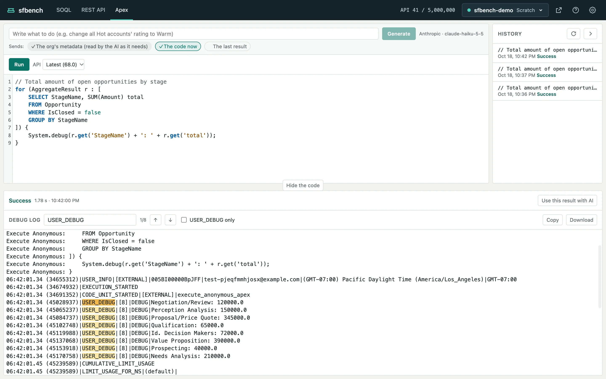

# Anonymous Apex

[Help contents](README.md)

On the Apex screen, you write anonymous Apex, run it, and see the result and the debug log.

The code is at the top, the history is on the right, and the result is below.

## Run

1. Write Apex in the code field. Apex and the SOQL in it are colored. Code of up to 32,000 characters can be run.
2. Choose the API version under API if needed. The default is the org's latest.
3. Click Run.

Only the Run button runs the code; ⌘↵ does not.

A run cannot be cancelled.
sfbench waits for as long as the Connection setting says.

In a production org, sfbench asks before running.
When the outcome of an earlier run of the same code is unknown (after a timeout, for example), sfbench asks too, even outside production.

## Read the result

The result's header shows whether it succeeded, how long it took and when it ran.
If you change the code after running it, the header says so.

A compile error or an exception shows its message and a button such as "Line 2, column 5".
Click it to move the cursor there in the code.
An exception also has its stack trace.
Note that what the code did outside Salesforce, such as callouts, is not rolled back when it fails.

With AI set up, a compile error or an exception comes with Fix with AI (see [Writing with AI](ai.md)).

## Read the debug log

The debug log is shown in full by default.

- **Search**: highlights every match of what you type in the search box. Enter or ↓ moves to the next match, ↑ to the previous one, and "3/12" tells which match you are on.
- **USER_DEBUG only**: shows only the lines from `System.debug`. Your browser remembers this choice.
- **Copy**, **Download**: copy the whole log, or save it as a `.log` file.

## History

Code you run is listed in the history on the right, with its first line, when it ran, and its outcome (success, compile error, the exception's type, and so on).
Click one to load the code into the code field. It is not run.
⌘Z (Ctrl+Z) undoes the load.

The history is saved per org in `~/.sfbench/apex-history/` on your machine.

## Build the next code from the last result

Click "Use this result with AI" in the result's header to pass the outcome and the `USER_DEBUG` lines to the AI.
See [Writing with AI](ai.md#use-the-last-result).
