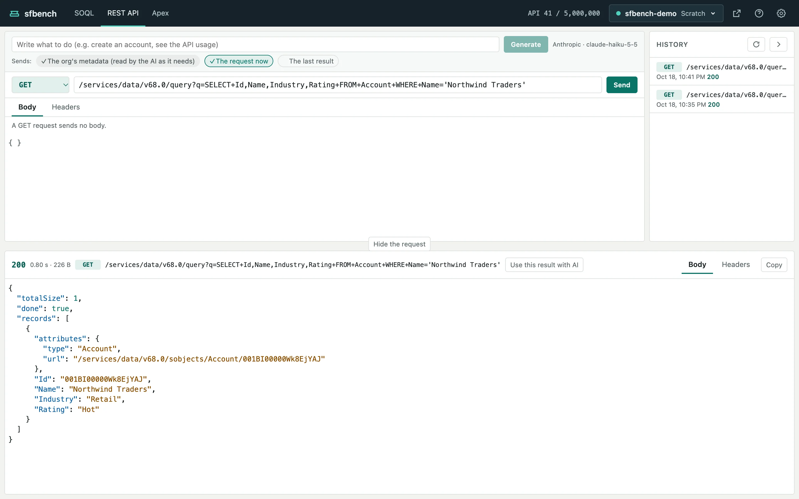

# REST API

[Help contents](README.md)

On the REST API screen, you send a request to the Salesforce REST API and see the response.

The request is at the top, the history is on the right, and the response is below.

## Send a request

1. Choose the method: GET, POST, PATCH, PUT or DELETE.
2. Enter the path from `/services/`, such as `/services/data/v68.0/sobjects/Account`. If you paste a full URL of the org, only its path and query string are sent.
3. For POST, PATCH and PUT, enter the JSON body on the Body tab. Format indents it.
4. Add headers on the Headers tab if needed.
5. Click Send.

Only the Send button sends a request.
Neither Enter in the path nor ⌘↵ sends it, so that a request that changes data is not sent by a stray key.

## Read the response

The response shows its status, time, size and body.
A JSON body is formatted and colored.
The Headers tab shows the response headers, and Copy copies the body.

4xx and 5xx answers are shown as responses, as Salesforce returned them, not as errors.
With AI set up, a 4xx or 5xx response comes with Fix with AI (see [Writing with AI](ai.md)).

## History

Requests you send are listed in the history on the right, with their method, path, time and status.
Click one to load it into the request fields. It is not sent.

The history is saved per org in `~/.sfbench/rest-history/` on your machine.

## Requests that may change data

A request other than GET, and a GET that may change data (`/services/apexrest/` and `executeAnonymous`), are treated as requests that may change data.

- In a production org, sfbench asks before sending one.
- While one is being sent, there is no Cancel: Salesforce cannot stop it halfway, so sfbench waits for the answer.
- When the outcome is unknown (after a timeout, for example), sfbench says so. If you send the same request again, sfbench asks first, even outside production. Salesforce may already have processed it, so check in Salesforce or in the history before you send it again.

## Build the next request from the last result

Click "Use this result with AI" in the response's header to pass the response to the AI.
For example, pass the response of an account search and ask "Create a contact for this account".
See [Writing with AI](ai.md#use-the-last-result).
