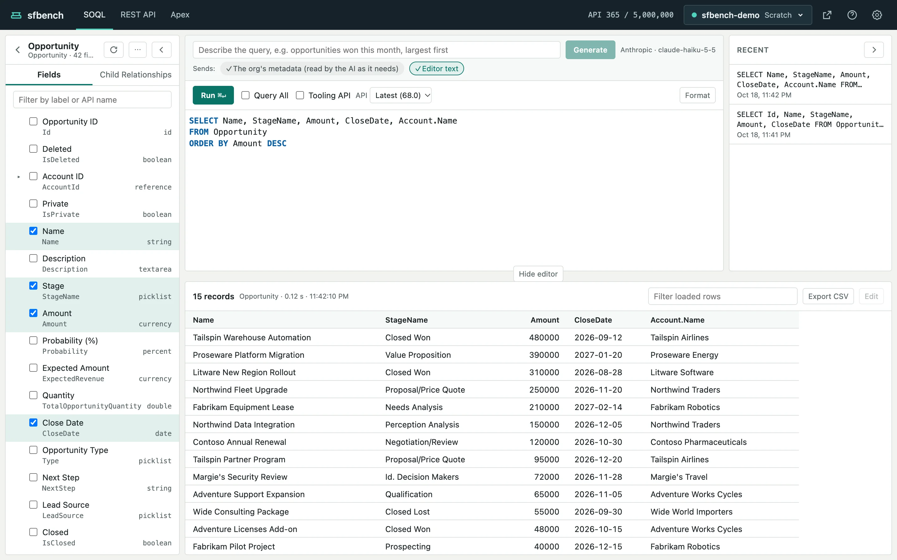
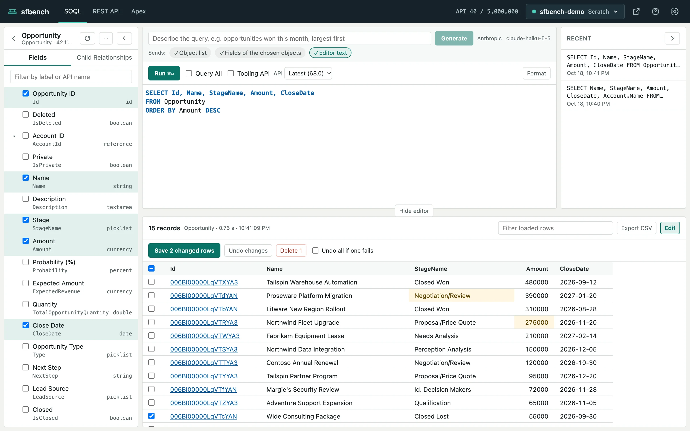

# SOQL

[Help contents](README.md)

On the SOQL screen, you build a query by picking fields, run it, and see the result in a table.
You can also edit values in the result table and save them, or delete rows.

The object and field list is on the left, the AI input, the editor and the recent queries are at the top right, and the result is below.

## Build a query

### Pick from the object and field list

1. Click an object in the list on the left. The editor becomes `SELECT Id FROM <object>`, and the list shows the object's fields.
2. Click a field's checkbox to add it to the SELECT clause or remove it.

A few things about the field list:

- Type in the box at the top to filter by label or API name.
- Click ▸ next to a lookup field to show the fields of the object it points to. Picking one adds a parent relationship field such as `Account.Name`.
- Fields picked on the Child Relationships tab become a subquery (`(SELECT ... FROM Contacts)`).
- The list follows the editor. When you change the object after FROM in the editor, the list switches to that object.

Changes made from the list can be undone with ⌘Z (Ctrl+Z on Windows and Linux).

### Write in the editor

The editor completes what fits where the cursor is: objects after FROM, the target's fields after `Account.`, and the child object's fields inside a subquery.

With "Omit the org's namespace prefix" on in the settings, you can leave out a managed package's namespace and write `Invoice__c`.

Format indents the query.

## Run

Click Run, or press ⌘↵ (Ctrl+Enter on Windows and Linux) in the editor.

The toolbar above the editor changes how the query runs:

- **Query All**: also returns deleted and archived records.
- **Tooling API**: runs the query with the Tooling API. The object list and completion switch to the Tooling API too. It cannot be on with Query All.
- **API**: the API version. The default is the org's latest; choose an older one to check how fields look in that version.

Queries you run are listed under Recent on the right.
Click one to load it into the editor, along with its Tooling API, Query All and API version.

When Salesforce rejects a query, the error shows where the result would be.
With AI set up, Fix with AI asks the AI to fix it (see [Writing with AI](ai.md)).

## Read the result

- The result loads more rows as you scroll, so you can go through tens of thousands of records from the top.
- 18-character record IDs link to the record in the org. Click Open org in the header once to log in, and the links open directly.
- A subquery column shows the number of child records. Click it to open the child records in a table under the result.
- Type in "Filter loaded rows" to filter the rows loaded so far. While filtering, more rows are not loaded as you scroll; click "Load the next N" when you need them.
- Export CSV writes every record of the result to a CSV file, whatever the filter. Over 10,000 records, sfbench shows how many API calls it will take and asks first.

## Edit in the result table

1. Click Edit in the result's header. It is unavailable for a result without Id in the SELECT clause, an aggregate result, and a Tooling API result.
2. Double-click a cell, or select it and press Enter, to edit it. Press Enter or click elsewhere to confirm, and Esc to cancel.
3. Changed cells are colored. Click "Save N changed rows" to save them.

You can edit the updateable fields of the object after FROM.
Parent relationship fields (`Account.Name`) and subquery records cannot be edited.

To delete records, select their rows with the checkboxes on the left of the table, and click "Delete N".
sfbench always asks before deleting, with the number of records.

With "Undo all if one fails" on, a save or a delete is undone entirely if any row fails.
With it off, the rows that succeed are kept.
A failed row gets a mark; click it to see Salesforce's error message.

If you run a query or switch orgs with unsaved changes, sfbench asks whether to discard them.

## Collapse panels

- Collapse the object and field list into a thin strip with the "<" button in its header.
- Collapse Recent with the ">" button in its header.
- Click "Hide editor", between the editor and the result, to fold the top into one line and give the result more room.
