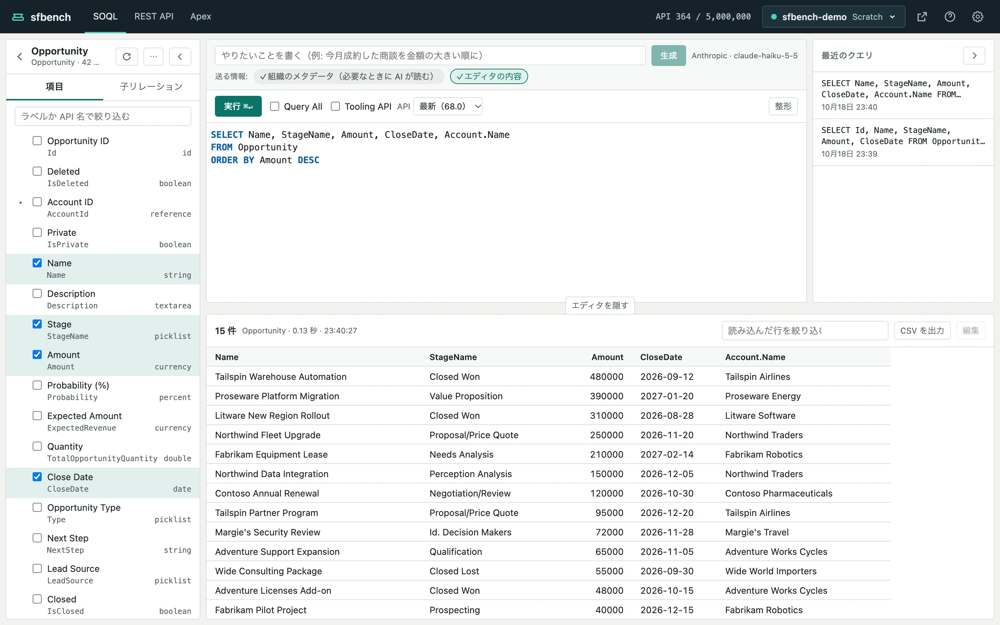
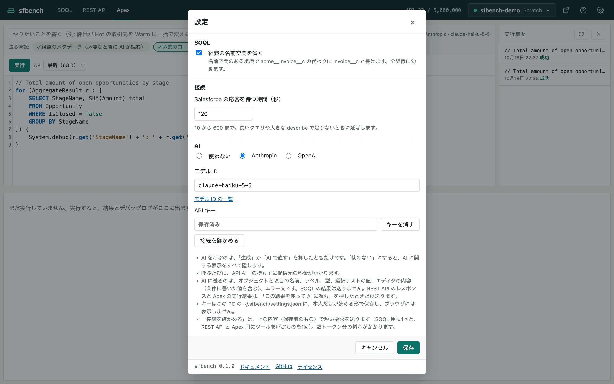

# sfbench のヘルプ

sfbench は、Salesforce の SOQL、REST API、匿名 Apex を手元のブラウザで実行するツールです。
認証は sf CLI に保存済みのものを使います。

[English](../en/README.md)

- [はじめに](#はじめに)（このページ）
- [SOQL](soql.md)
- [REST API](rest.md)
- [匿名 Apex](apex.md)
- [AI で組む](ai.md)
- [困ったとき](troubleshooting.md)

## はじめに

### 必要なもの

- Node.js 22.21.0 以上の 22 系、または 24.5.0 以上
- [Salesforce CLI](https://developer.salesforce.com/tools/salesforcecli)（`sf`）

使う組織には、sf CLI でログインしておきます。

```
sf org login web -a my-org
```

### 起動する

```
npx sfbench
```

ブラウザで sfbench が開きます。
sf CLI に既定の組織（`sf config set target-org <alias>` で設定したもの）があれば、その組織で開きます。
別の組織で開くときは `-o` で指定します。

```
npx sfbench -o my-org
```

sfbench は手元で小さな Web サーバーを起動し、Salesforce への問い合わせはこのサーバーが行います。
アクセストークンがブラウザやほかのサーバーに渡ることはありません。
サーバーは自動では止まりません。
止めるときは次のコマンドを実行します。

```
npx sfbench stop
```

### 画面の見かた



画面の上の帯（ヘッダー）には、左から次のものが並びます。

- **タブ**：SOQL、REST API、Apex の画面を切り替えます。切り替えても、それぞれの画面の入力と結果は残ります。
- **API 使用量**：組織の API の呼び出し回数と上限です。
- **組織の切り替え**：いま使っている組織のエイリアスと種別です。押すと組織の一覧が開きます。
- **組織を開く**（外部リンクのアイコン）：ログイン済みの状態で、組織のホームを別のタブに開きます。一度開いておくと、結果のレコード ID のリンクもそのまま開けます。
- **?**：このヘルプを開きます。
- **歯車**：設定を開きます。

### 組織を切り替える

組織の切り替えを押すと、sf CLI にログイン済みの組織が一覧で出ます。
上の欄にエイリアスかユーザー名を入れると絞り込めます。

- 本番の組織は赤系の色で示します。本番の組織を選ぶと、ヘッダーの下に赤い帯で「本番」と出ます。
- スクラッチ組織には有効期限を出します。
- ログインし直しが必要な組織は、一覧の下に「再ログインが必要な組織」としてまとめ、ログインし直すコマンドをコピーできるようにします。

組織を切り替えると、エディタの内容や結果などの作業中の内容は消えます。

### 本番の組織での確認

本番の組織では、データを変えうる操作の前に確認のダイアログを出します。
対象は、REST API の GET 以外の送信、Apex の実行、結果の表での保存です。
SOQL の実行は読み取りだけなので確認しません。

### 設定

ヘッダーの歯車で設定を開きます。



- **SOQL**：「組織の名前空間を省く」がオンだと、名前空間のある組織で `acme__Invoice__c` の代わりに `Invoice__c` と書けます。
- **接続**：Salesforce の応答を待つ時間（秒）です。長いクエリや大きな describe で足りないときに延ばします。
- **AI**：AI の提供元、モデル ID、API キーです。詳しくは [AI で組む](ai.md) にあります。

設定、最近のクエリ、REST API と Apex の実行履歴は、この PC の `~/.sfbench/` に保存します。

### AI のエージェントから開く

Claude Code などの AI のエージェントは、クエリや要求を入れた状態で sfbench を開けます。
エージェントはまだ sfbench を知らないので、指示ファイル（`CLAUDE.md` や `AGENTS.md`）に使い方を書いておきます。
書く内容は [README](../../README.ja.md#ai-のエージェントから使う) にあります。

```
npx -y sfbench -o my-org --query "SELECT Id, Name FROM Account" --run
npx -y sfbench -o my-org --rest /services/data/v62.0/sobjects/Account --method POST --body-file account.json
npx -y sfbench -o my-org --apex-file fix-data.apex
```

`--query` に `--run` を付けると、実行した結果を開きます。
REST API の要求と Apex は、データを変えうるので、入れた状態で開くだけです。
送信や実行は、内容を確かめてから画面のボタンで行います。
引数の一覧は [README](../../README.ja.md#コマンドライン引数) にあります。
