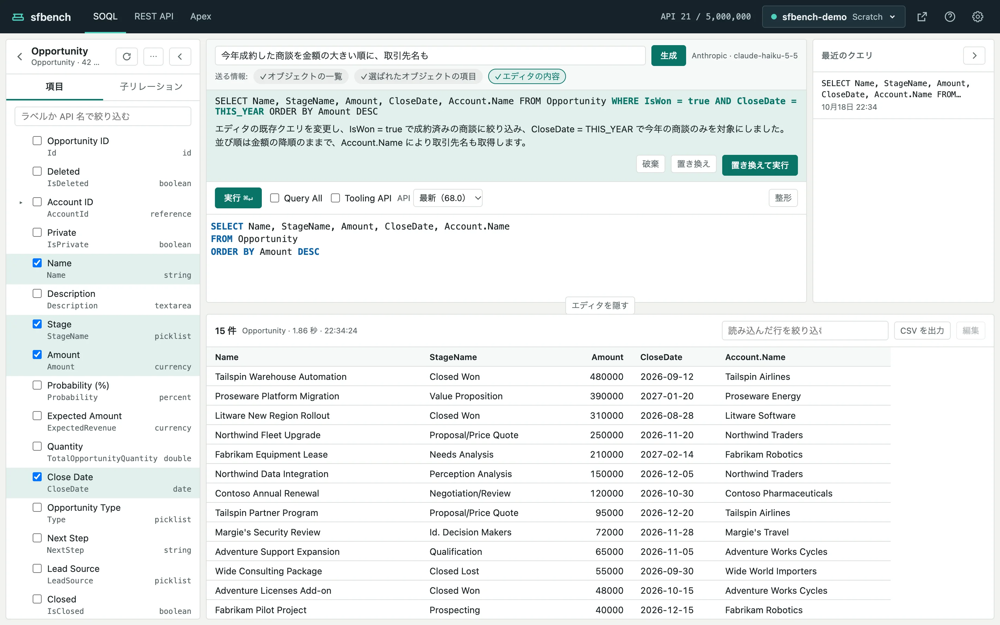
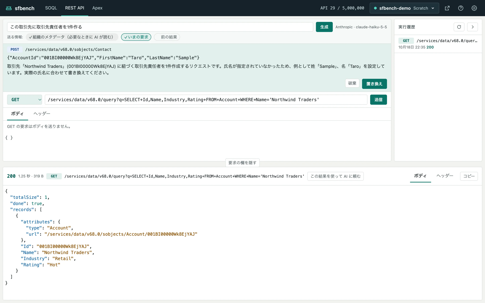

# AI で組む

[ヘルプの目次](README.md)

やりたいことを書くと、AI が SOQL、REST API の要求、匿名 Apex を組みます。
失敗したクエリ、要求、Apex を、エラー文をもとに AI に直させることもできます。

## 使えるようにする

AI の利用には、Anthropic か OpenAI の API キーが要ります。
AI を呼ぶたびに、API キーの持ち主に提供元の料金がかかります。

1. ヘッダーの歯車で設定を開きます。
2. 「AI」で Anthropic か OpenAI を選びます。
3. モデル ID を入れます。使えるモデル ID は「モデル ID の一覧」のリンクから確かめられます。
4. API キーを入れます。
5. 「接続を確かめる」を押すと、入れた内容で短い要求を送って確かめます。数トークン分の料金がかかります。
6. 「保存」を押します。

API キーはこの PC の `~/.sfbench/settings.json` に、本人だけが読める形で保存します。
保存したキーはブラウザには表示しません。
「使わない」を選ぶと、AI に関する表示をすべて隠します。

## 頼む

各画面のいちばん上の欄に、やりたいことを書いて「生成」を押します（Enter でも送れます）。

- SOQL の画面：「今月成約した商談を金額の大きい順に」
- REST API の画面：「取引先を1件作る」「API の使用状況を見る」
- Apex の画面：「評価が Hot の取引先を Warm に一括で変える」

AI は組織のオブジェクトと項目を調べてから組みます。
エディタに書きかけのクエリやコードがあれば、それを手がかりにします。

## 提案を取り込む

AI の答えは、入力欄の下に提案として出ます。
エディタに中身があるときは、変更前との差分を出します。
提案は、ボタンを押すまで画面の内容を変えません。

- **破棄**：提案を捨てます。
- **置き換え**：提案でエディタや要求の欄を置き換えます。⌘Z（Ctrl+Z）で元に戻せます。
- **置き換えて実行**（SOQL だけ）：置き換えて、そのまま実行します。

REST API の要求と Apex は、置き換えても送信や実行はしません。
内容を確かめてから、自分で「送信」か「実行」を押します。

## AI で直す

次の失敗には「AI で直す」が出ます。

- SOQL：Salesforce がクエリを断ったとき
- REST API：4xx か 5xx のレスポンスが返ったとき
- Apex：コンパイルエラーか例外になったとき

押すと、失敗したクエリ、要求、コードとエラー文を AI に渡し、直した案を提案として出します。

## 前の結果を使う

REST API と Apex の画面では、直前の結果を AI に渡して、次の要求やコードを組ませられます。

1. レスポンスか実行結果の見出しの「この結果を使って AI に頼む」を押します。
2. AI の入力欄にカーソルが移り、「前の結果」の札がオンになります。
3. やりたいことを書いて「生成」を押します。

前の結果にはレコードの値が含まれうるので、「前の結果」は既定でオフです。
渡すのは1回だけで、生成すると札はオフに戻ります。
結果が長いときは、先頭の一部だけを渡します。

## AI に送る情報

入力欄の下の札が、AI に送る情報を示します。
✓の付いた札が、送るものです。

| 画面 | いつも送るもの | 札で切り替えるもの |
| --- | --- | --- |
| SOQL | 組織のメタデータ（AI が必要なときに読む） | エディタの内容 |
| REST API | 組織のメタデータ（AI が必要なときに読む） | いまの要求、前の結果 |
| Apex | 組織のメタデータ（AI が必要なときに読む） | いまのコード、前の結果 |

組織のメタデータとは、オブジェクトと項目の名前、型、ラベル、選択リストの値です。
「AI で直す」では、加えてエラー文を送ります。

SOQL の結果は送りません。
REST API のレスポンスと Apex の実行結果は、「この結果を使って AI に頼む」を押したときだけ送ります。
エディタの内容には、条件に書いた値も含まれます。
