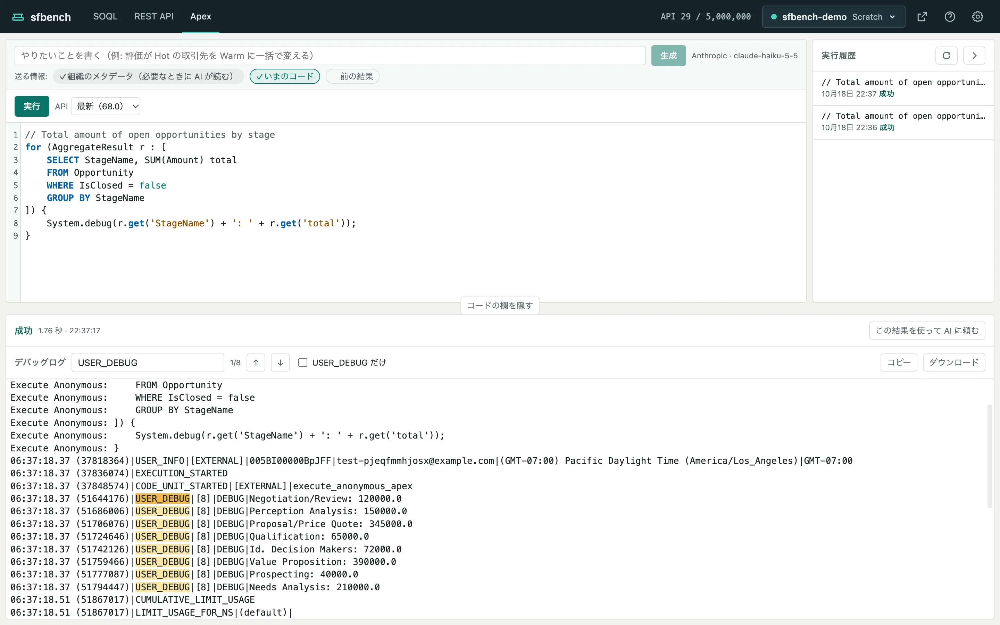

# 匿名 Apex

[ヘルプの目次](README.md)

Apex の画面では、匿名 Apex を書いて実行し、結果とデバッグログを見ます。

上にコードの欄、右に実行履歴、下に実行結果があります。

## 実行する

1. コードの欄に Apex を書きます。Apex と、その中の SOQL を色分けします。コードは32,000文字まで実行できます。
2. 必要なら「API」で API バージョンを選びます。既定は組織の最新です。
3. 「実行」を押します。

実行は「実行」ボタンだけで行います。
⌘↵ では実行しません。

実行中は取り消せません。
Salesforce の応答を待つ時間（設定の「接続」）まで待ちます。

本番の組織では、実行の前に確認します。
タイムアウトなどで前の実行の結果が分からないときも、同じコードを実行する前に、本番でなくても確認します。

## 結果を見る

実行結果の見出しに、成功かどうか、所要時間、実行した時刻が出ます。
実行したあとでコードを書き換えると、そのことを添えます。

コンパイルエラーと例外では、メッセージと「2行目 5列」のようなボタンが出ます。
ボタンを押すと、コードのその位置へカーソルが移ります。
例外ではスタックトレースも開けます。
例外で処理が止まっても、コールアウトなどの外部への影響は戻らないことに注意してください。

AI を設定していれば、コンパイルエラーと例外には「AI で直す」が出ます（[AI で組む](ai.md)）。

## デバッグログを読む

デバッグログは、既定で全文を出します。

- **検索**：検索の欄に入れた文字に一致する箇所をすべて色付けします。Enter か ↓ で次の一致へ、↑ で前の一致へ移り、「3/12」のように何件目かを出します。
- **USER_DEBUG だけ**：`System.debug` で出した行だけにします。この切り替えはブラウザに覚えます。
- **コピー**、**ダウンロード**：ログの全文をコピーするか、`.log` のファイルに保存します。

## 実行履歴

実行したコードは、右の実行履歴に残ります。
各行に、コードの最初の行、実行した時刻、結果（成功、コンパイルエラー、例外の型など）が出ます。
行を押すと、そのコードをコードの欄に読み込みます（実行はしません）。
読み込みは ⌘Z（Ctrl+Z）で元に戻せます。

実行履歴は組織ごとに、この PC の `~/.sfbench/apex-history/` に保存します。

## 前の結果を使って次のコードを作る

実行結果の見出しの「この結果を使って AI に頼む」を押すと、実行の結果と `USER_DEBUG` の行を AI に渡せます。
詳しくは [AI で組む](ai.md#前の結果を使う) にあります。
