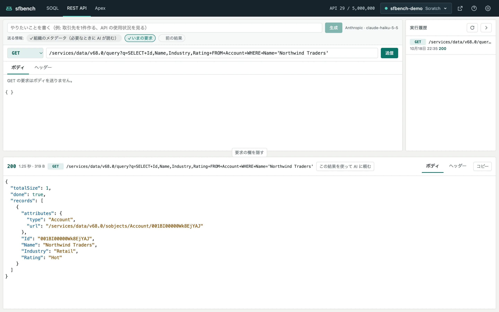

# REST API

[ヘルプの目次](README.md)

REST API の画面では、Salesforce の REST API に要求を送り、レスポンスを見ます。

上に要求の欄、右に実行履歴、下にレスポンスがあります。

## 要求を送る

1. メソッド（GET、POST、PATCH、PUT、DELETE）を選びます。
2. パスを入れます。`/services/data/v68.0/sobjects/Account` のように、`/services/` から書きます。組織の URL ごと貼り付けても、パスとクエリ文字列だけを送ります。
3. POST、PATCH、PUT では、「ボディ」のタブに JSON を入れます。「整形」で字下げできます。
4. 必要なら「ヘッダー」のタブでヘッダーを足します。
5. 「送信」を押します。

送るのは「送信」ボタンだけです。
パスの欄で Enter を押しても、⌘↵ を押しても送りません。
データを変える要求を、キーの押し間違いで送らないためです。

## レスポンスを見る

レスポンスには、ステータス、所要時間、大きさ、本文が出ます。
JSON の本文は整形して色分けします。
「ヘッダー」のタブでレスポンスのヘッダーを、「コピー」で本文をコピーできます。

4xx と 5xx も、エラーではなくレスポンスとして、Salesforce が返したとおりに出します。
AI を設定していれば、4xx と 5xx のレスポンスには「AI で直す」が出ます（[AI で組む](ai.md)）。

## 実行履歴

送った要求は、右の実行履歴に残ります。
各行に、メソッド、パス、送った時刻、ステータスが出ます。
行を押すと、その要求を要求の欄に読み込みます（送りはしません）。

実行履歴は組織ごとに、この PC の `~/.sfbench/rest-history/` に保存します。

## データを変える要求の扱い

GET 以外の要求と、GET でもデータを変えうる要求（`/services/apexrest/` と `executeAnonymous`）は、データを変えうる要求として扱います。

- 本番の組織では、送る前に確認します。
- 送信中はキャンセルを出しません。Salesforce の側の処理は途中で止められないので、応答を待ちます。
- タイムアウトなどで結果が分からなかったときは、その旨を出します。同じ要求を送り直そうとすると、本番でなくても確認します。Salesforce の側で処理が終わっていることがあるので、Salesforce か実行履歴で確かめてから送り直してください。

## 前の結果を使って次の要求を作る

レスポンスの見出しの「この結果を使って AI に頼む」を押すと、そのレスポンスを AI に渡せます。
たとえば、取引先を検索したレスポンスを渡して「この取引先に取引先責任者を1件作る」と頼めます。
詳しくは [AI で組む](ai.md#前の結果を使う) にあります。
