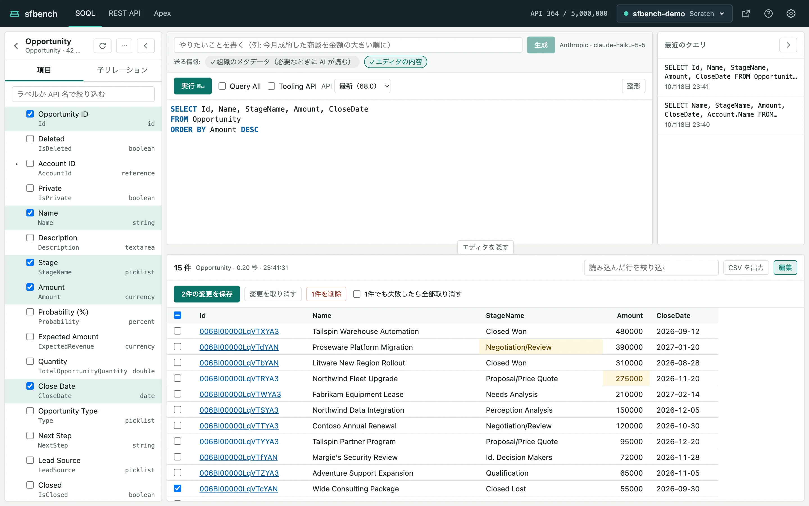

# SOQL

[ヘルプの目次](README.md)

SOQL の画面では、項目を選んでクエリを組み立て、実行した結果を表で見ます。
結果の表で値を書き換えて保存したり、行を削除したりもできます。

左にオブジェクトと項目の一覧、右上に AI の入力欄とエディタと最近のクエリ、下に結果があります。

## クエリを組み立てる

### オブジェクトと項目の一覧から選ぶ

1. 左の一覧でオブジェクトを押します。エディタが `SELECT Id FROM <オブジェクト>` になり、一覧が項目に切り替わります。
2. 項目のチェックボックスを押すと、SELECT 句に足したり外したりします。

項目の一覧について、次のことを覚えておくと便利です。

- 上の欄に入れた文字で、ラベルか API 名を絞り込めます。
- 参照項目の左の ▸ を押すと、参照先のオブジェクトの項目が出ます。選ぶと `Account.Name` のような親リレーションの項目になります。
- 「子リレーション」のタブで選んだ項目は、サブクエリ（`(SELECT ... FROM Contacts)`）になります。
- 一覧はエディタの内容に追従します。エディタで FROM のオブジェクトを書き換えると、左の一覧もそのオブジェクトに切り替わります。

一覧やエディタの書き換えは、⌘Z（Windows と Linux では Ctrl+Z）で元に戻せます。

### エディタで書く

エディタでは、カーソルの位置に合わせて補完の候補が出ます。
FROM のあとではオブジェクト、`Account.` のあとでは参照先の項目、サブクエリの中では子オブジェクトの項目が候補になります。

設定の「組織の名前空間を省く」がオンなら、管理パッケージの名前空間を省いて `Invoice__c` のように書けます。

「整形」を押すと、クエリを字下げして読みやすくします。

## 実行する

「実行」を押すか、エディタで ⌘↵（Windows と Linux では Ctrl+Enter）を押します。

エディタの上のツールバーで、実行のしかたを変えられます。

- **Query All**：削除済みやアーカイブ済みのレコードも対象にします。
- **Tooling API**：Tooling API でクエリを実行します。オブジェクトの一覧や補完も Tooling API のものに切り替わります。Query All とは同時に使えません。
- **API**：使う API バージョンです。既定は組織の最新で、古いバージョンでの項目の見え方を確かめるときに変えます。

実行したクエリは、右の「最近のクエリ」に残ります。
押すとエディタに読み込みます。
そのときの Tooling API、Query All、API バージョンの指定も戻ります。

Salesforce がクエリを断ったときは、結果の位置にエラー文が出ます。
AI を設定していれば、「AI で直す」で AI に直させることもできます（[AI で組む](ai.md)）。

## 結果を見る

- 結果は、スクロールに合わせて続きを読み込みます。数万件でも、先頭から順に見られます。
- 18桁のレコード ID は、組織のレコードの画面へのリンクです。ヘッダーの「組織を開く」で一度ログインしておくと、そのまま開けます。
- サブクエリの列は件数を出します。押すと、結果の下に子レコードの表が開きます。
- 「読み込んだ行を絞り込む」の欄に入れた文字で、読み込み済みの行を絞り込めます。絞り込んでいる間は続きを自動で読み込まないので、必要なら「次の N 件を読み込む」を押します。
- 「CSV を出力」は、絞り込みに関係なく全件を CSV に出します。1万件を超えるときは、API の呼び出し回数の見込みを出して確認します。

## 結果の表で編集する

1. 結果の見出しの「編集」を押します。Id を SELECT していない結果、集計の結果、Tooling API の結果では押せません。
2. セルをダブルクリックするか、セルを選んで Enter を押すと、入力欄になります。Enter かほかの場所を押すと確定し、Esc で取り消します。
3. 変えたセルは色が変わります。「N件の変更を保存」で保存します。

書き換えられるのは、FROM のオブジェクト自身の項目のうち、更新できる項目だけです。
親リレーションの項目（`Account.Name`）とサブクエリのレコードは書き換えられません。

行を削除するときは、表の左端のチェックボックスで行を選び、「N件を削除」を押します。
削除の前には、件数を示して確認します。

「1件でも失敗したら全部取り消す」をオンにすると、1件でも失敗したときにその保存や削除をすべて取り消します。
オフのときは、成功した行だけが反映されます。
失敗した行には印が付き、押すと Salesforce のエラー文が出ます。

保存していない変更があるときに、クエリを実行したり組織を切り替えたりすると、変更を捨ててよいか確認します。

## パネルを畳む

- 左の一覧は、見出しの「<」で細い帯に畳めます。
- 最近のクエリは、見出しの「>」で畳めます。
- エディタと結果の境目の「エディタを隠す」で、上の段を1行に畳み、結果を広く見られます。
